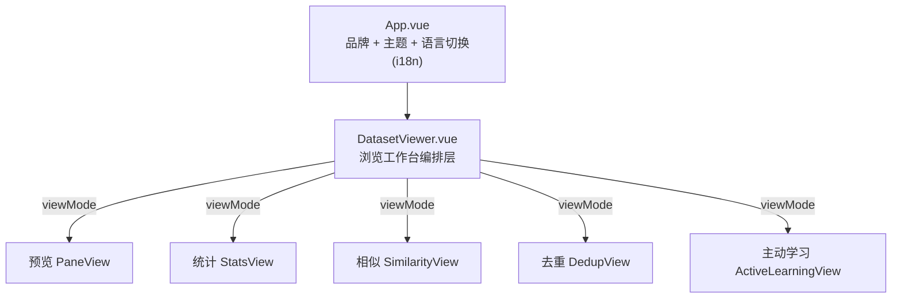
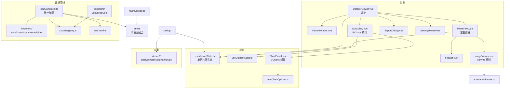

# PROJECT_ARCHITECTURE - 架构蓝图

> 最后更新：2026-07-18 | 只含模块依赖和 DTO，不含实现代码

## 项目定位

**DV-DatasetManager（DataVision）** — 本地优先的 AI 数据集管理与清洗工具，弥补市面开源/商业工具短板（开文件夹即用、离线/隐私友好、零 Python 环境）。
- 浏览器版（Chrome/Edge `showDirectoryPicker`）
- 客户端版（Tauri 2，完整文件权限）

## 顶层布局



`App.vue`（2026-07-17 重组后）不再做顶层 Tab 路由，只保留品牌、主题选择、语言切换（`el-config-provider` 同步 ElementPlus locale），统一挂载 `DatasetViewer`。浏览工作台内部由 `useViewerState.viewMode` 切换五个**平级视图**：`preview`（PaneView）/ `stats`（StatsView）/ `similarity`（SimilarityView）/ `dedup`（DedupView）/ `active`（ActiveLearningView），全部共享已加载的数据集。

## 模块依赖图



## 模块说明与 DTO

### 1. env.ts — 环境适配层
统一浏览器/Tauri 文件操作 API。

| 导出 | 类型 | 说明 |
|------|------|------|
| `env` | `EnvType` | `'browser' \| 'tauri'`（`'__TAURI__' in window` 判定） |
| `pickDirectoryBrowser()` | `Promise<FileSystemDirectoryHandle \| null>` | 选择文件夹（浏览器） |
| `readDirBrowser(handle)` | `Promise<{path,file}[]>` | 递归读取（浏览器） |
| `readFileAsArrayBuffer(file)` | `Promise<ArrayBuffer>` | 读字节 |
| `parseImageSize(buf)` | `(width,height) \| null` | **零解码**从字节头部解析宽高（JPEG/PNG/GIF/BMP/WebP），主线程零开销 |
| `getImageDimensions(file)` | `Promise<{width,height}>` | 整图解码取尺寸（仅单张导出等低频场景） |

> 缩略图功能已整体移除，不再有 `generateThumbnail`。

### 2. types.ts — 核心类型定义

```typescript
interface ImageFile {
  id: string; name: string; path: string;
  size: number; width: number; height: number;
  hash?: string; phash?: string; dhash?: string; ahash?: string;
  blob?: Blob; url?: string;        // url 由 Blob URL 全局 LRU 懒生成
  sourceFile?: File;                // 浏览器端原始句柄（切图时懒生成预览 URL）
}
// 注意：已无 thumbnail 字段

interface DataSet {
  id: string; name: string;
  files: Map<string, ImageFile>;
  fileList: ImageFile[];
  totalCount: number; dupCount: number; uniqueCount: number;
  structureAnalysis?: StructureAnalysisResult;
  annotationFiles?: Map<string, AnnotationFile>;
  canonical?: CanonicalDataset;     // 归一化中间模型（导入器生成）
  annotations?: Map<string, ParsedAnnotation[]>; // 路径 -> 标注（兜底）
}

interface ParsedAnnotation {
  type: 'bbox' | 'polygon' | 'circle' | 'rotation' | 'keypoint' | 'polyline';
  bbox?: [number, number, number, number];
  points?: [number, number][];
  category: string;
  normalized?: boolean;             // YOLO 等为 true
  color?: string;
  confidence?: number;              // 置信度 (0-1)
  description?: string;             // 文本描述
}
```

### 3. dataset/ — Canonical 统一管线
- `dataset/types.ts`：`CanonicalDataset` / `CanonicalSample` / `CanonicalAnnotation` / `ClassDef`；bbox 统一存归一化 YOLO `[cx,cy,w,h]`(0~1)，polygon 存归一化点。
- `loadCanonical.ts`：`loadDatasetCanonical()` 统一入口，循环内用 `parseImageSize(bytes)` 解析尺寸，主线程零解码。
- `importers/`：`detectFormat()` 自动识别 `yolo/coco/voc/labelme/folder`，各自归一化为 `CanonicalDataset`。
- `classRegistry.ts`：类别规范化，别名归并（Cat/cat/CAT 合一）。
- `dataYaml.ts`：最小 data.yaml 解析（未引 js-yaml）。
- `exporters/`：`exportDatasetZip()` + `yolo/coco/voc` 导出器 + `rebalanceSplits` 重划分。

### 4. composables/ — 共享状态与纯逻辑
- `useViewerState.ts`（**模块级单例**）：`datasets`/`categoryColorMap`/`dualPane`/`activePane` 等全局状态 + `leftPane`/`rightPane` 两个**独立 `PaneState`**（各自 search/sort/filter/selected/面板折叠）。底部同步切换 `prevFileSync/nextFileSync` 与 `syncPrevActive/syncNextActive`。
- `useDatasetStats.ts`：`computeStatsFor(scopedDatasets, selectedName?)` 可复用统计；`datasetStats` computed 默认叠加所有数据集或单选。
- `useChartOptions.ts`：ECharts `setOption` 配置工厂。
- `useTheme.ts`：浅色/深色/系统。

### 5. dedup/ — 去重模块
- `analyze.ts`：编排去重 + 脏数据 + 泄漏检测。
- `hashEngine.ts` / `hash.worker.ts`：四哈希计算（MD5/pHash/dHash/aHash）。
- `strength.ts`：三档强度预设。
- `splitDetect.ts`：子集识别（canonical 优先，路径推断兜底）。
- `fileOps.ts`：基于真实 sourcePath 的删除。
- `report.ts`：结果汇总。

### 6. annotationParser.ts — 标注解析
- 输入：文件 Map、图片路径列表、颜色分配函数
- 输出：`Map<string, ParsedAnnotation[]>`（图片路径 → 标注列表）
- 支持：COCO JSON / LabelMe JSON / YOLO TXT / VOC XML

### 7. hashService.ts — 哈希计算
- MD5（`spark-md5`）、pHash/dHash/aHash（自定义实现）
- 通过 WebWorker 计算，不阻塞 UI

## 目录结构

```
src/
├── components/
│   ├── DatasetViewer.vue     # 浏览编排层（父子组件共享 useViewerState）
│   ├── ViewerHeader.vue      # 顶部工具条
│   ├── PaneView.vue          # 单/双窗格容器（左右独立状态）
│   ├── FileList.vue          # 文件列表（按 id，无缩略图）
│   ├── ImageViewer.vue       # canvas 绘制（原语抽 canvas/）
│   ├── StatsView.vue         # ECharts 统计（概览/对比）
│   ├── ChartPanel.vue        # ECharts 封装组件
│   ├── StatBarList.vue       # 图片明细列表
│   ├── ExportDialog.vue      # 导出对话框
│   ├── SettingsPanel.vue     # 显示设置
│   └── DatasetStructureDialog.vue
├── canvas/canvasDraw.ts      # 纯绘制原语（不持状态）
├── composables/
│   ├── useViewerState.ts
│   ├── useDatasetStats.ts
│   ├── useChartOptions.ts
│   └── useTheme.ts
├── dataset/
│   ├── importers/  (yolo/coco/voc/labelme/folder/index/shared)
│   ├── exporters/  (yolo/coco/voc/index/types)
│   ├── loadCanonical.ts  classRegistry.ts  dataYaml.ts  naming.ts  split.ts  types.ts
├── dedup/  (analyze/hashEngine/hash.worker/fileOps/strength/splitDetect/report/types)
├── styles/  (variables/dark/dedup/image-viewer/viewer .less)
├── annotationParser.ts  annotationService.ts  datasetService.ts  datasetServiceV2.ts
├── datasetStructureAnalyzer.ts  env.ts  hashService.ts  types.ts  worker.ts  App.vue
```

## 补充模块（2026-07 落地，原蓝图未覆盖）

> 以下模块在 2026-07 的「轻量标注编辑 + 格式覆盖补全 + 规模化算力」迭代中落地，原架构蓝图未含。

### 8. 标注格式覆盖补全（`src/dataset/` + `src/codec/` + `src/canvas/`）
- `dataset/importers/dota.ts` / `dataset/exporters/dota.ts`：DOTA 8 角点像素 ↔ 归一化 OBB（`rotation` 弧度 CCW）。
- `dataset/exporters/` 现含 `yolo/coco/voc/dota/labelme/index/types`；YOLO 变体 6 列=obb（角度制）、`5+3k`=pose。
- `codec/rle.ts`：COCO RLE 掩码解码（像素级绘制前置）。
- `canvas/canvasEdit.ts`：纯几何（fit 变换、8 手柄命中/resize、OBB 旋转重算、关键点拖拽）。
- `dataset/annotationIO.ts`：`buildSaveFiles`/`saveAnnotations`——YOLO/VOC/LabelMe 按文件写回、COCO 按 split 整 JSON 重写；`saveAnnotationsTauri`/`saveAnnotationsBrowser`（ZIP）。

### 9. 轻量标注编辑（清洗台，`ImageViewer.vue` + `SidebarPanel.vue`）
- `ImageViewer.vue`：交互状态机 `dragMode`(pan/move/resize/draw/rotate) + `dragSub`(bbox/polygon/mask/obb/keypoints/kp-point)；`drawDrawPreview` 实时落点/橡皮筋/尺寸。
- `SidebarPanel.vue`：工具条（选择/画框、新框类别、撤销/重做、保存(脏文件数)）+ 每条标注改类/删除。
- `useViewerState`：`EditCommand{apply,revert}` 撤销栈、`dirtyFiles:Set` 脏标记、`Delete` 删选中。

### 10. 质量检查（`src/quality/`）
- `engine.ts`：模糊/过暗/过亮/低分辨率/单色检测 + 0-100 评分 + 聚合统计；`report.ts` HTML/PDF 报告（`window.print()` 另存 PDF）。
- `useQuality.ts` 单例编排；`QualityView.vue` + 文件行徽标 + 质量 tab + 阈值设置。

### 11. 规模化算力与缓存层（`src/workers/` + `src/cache/`）
- `workers/workerPool.ts`：通用 Worker 池（默认 4-8 并行），哈希/质量各一池。
- `cache/idbCache.ts`：IndexedDB 双层缓存（hashes/quality 按 md5 内容寻址 + statIndex 按 `path::size`），批量写 + `getCacheStats`/`clearCache`。
- 底层哈希/`hash.worker.ts` 复用 `dedup/`；质量走独立 Worker。

### 12. 训练框架配置导出（`src/dataset/exporters/` 或独立服务）
- YOLOv8 / MMDetection / Detectron2 工程配置 + `data.yaml`/`classes.txt` 一键导出可直接训练 ZIP（超参可调）。

## 补充模块（2026-07-17 ~ 07-18 落地，原蓝图未覆盖）

### 13. 数据策展：特征嵌入 + 相似检索 + 降维 + 离群（`src/embed/` + `SimilarityView.vue`）
- `embedModel.ts`：`onnxruntime-web`(WASM) 本地抽取 EfficientNet-B0 特征（输出 1280 维）；`ort.env.wasm.wasmPaths = { mjs, wasm }` 经 Vite `?url` 静态资源提供，无需 public 文件。
- 特征经 `WorkerPool` 并行 + IndexedDB 内容寻址缓存（`idbCache` `embeddings` store）。
- `findSimilar`（暴力余弦 Top-K）/ `reduce.ts`（PCA 幂迭代 + `umap-js`）/ `outlier.ts`（kNN 余弦离群度 Top-20）。`SimilarityView.vue` 两标签：相似检索、降维 & 离群（ECharts 散点联动预览）。

### 14. 统一报表模块（`src/report/reportHtml.ts`）
- `generateReportHtml(ReportOptions)` 数据驱动 + `downloadReportHtml` / `printReportHtml`（隐藏 iframe + `window.print()` 另存 PDF）+ `escapeHtml`。质量/统计/相似/去重全部复用，单文件内联样式、零额外依赖。

### 15. 数据集版本 / 迭代间 diff（`src/dataset/versioning.ts` + `versionStore.ts` + `VersionDialog.vue`）
- `DatasetVersionManifest` 轻量可 diff（类表 / split 计数 / 每类标注数 / 每样本 `{id,sourcePath,split,annCount,annHash}`，`annHash` 经 FNV-1a 定点舍入算出）。
- `diffManifests(after,before)` 纯内存比对（新增/删除/修改/类变化/split 变化）。存储：Tauri 写数据集根 `dataset.dv.json`（自标识，detectMarker 识别）+ IDB 历史（`idbCache` v3 `versions` store）；浏览器 IDB + 下载/导入标识文件。

### 16. 工作区结构配置持久化（`src/workspace/workspaceStore.ts` + `loadCanonical.ts` 重建）
- `WorkspaceConfig` = `datasets[]`（Tauri `imageRoot`/`labelRoot` 或浏览器 `handleKey`）+ `panes[]` + `activePane` + 视图/显示设置；浏览器目录句柄以 `PersistedHandles` 单独存 `handles` 表（结构化克隆）。
- `idbCache` v4 新增 `workspace`（单条 `id='current'`）+ `handles` store；`reloadDatasetFromPaths`（Tauri 重扫）/ `reloadDatasetFromHandles`（浏览器重导入）；`useViewerState` 集成保存/恢复（自动防抖 800ms + `autoRestore` 开关）。

### 17. 主动学习钩子（`src/activeLearning/` + `ActiveLearningView.vue`）
- 预测作为**覆盖层**独立存储，绝不回写 canonical 真值。`types.ts` `scorePredictions`（confMin/Mean/Max + hardScore）；`importPredictions.ts` 解析 COCO predictions / 信封 / 对象映射三形态（bbox_format 归一化 + 类名对齐 dataset.classes）；`useActiveLearning.ts` 模块级单例，仅会话内、不写盘。
- `render.ts` `predictionsToParsed` 把预测转 `ParsedAnnotation` 叠加渲染（`canvasDraw.drawAnnotation` 加 `prediction`/`overrideColor`，品红虚线「P:」前缀）；`ImageViewer` 加 `predictions`/`showPredictions`，`SettingsPanel`「显示预测框」开关。

### 18. 增强预览（`src/augment/` + `AugmentPreview.vue` / `AugmentCard.vue`）
- `transforms.ts`：单一仿射矩阵 `Plan.aff` 同时作用于图像像素与归一化标注点，保证增强后图与框/点/多边形严格对齐；12 种增强（翻转/旋转/裁剪/亮度/对比度/色相/饱和度/模糊/加噪）。
- `decode.ts`：按 env 解码 ImageFile（`crossOrigin='anonymous'` 两段式加载，避免 `getImageData` 跨域污染）。纯前端预览、非破坏式，`PaneView` 工具栏「增强预览」入口。

### 19. 拖拽上传 + 多语言 i18n（`src/composables/useFolderDrop.ts` + `src/i18n/`）
- `useFolderDrop.ts`：双端拖放组合式函数——Tauri `getCurrentWebview().onDragDropEvent` 取绝对路径 → `{imageRoot}`；浏览器 HTML5 拖放 + `getAsFileSystemHandle()` 取目录句柄 → `{imageHandle}`，统一复用 `handleLoadDataset(opts)` 免弹框。`DatasetViewer` 加拖放高亮覆盖层。
- `src/i18n/`：`index.ts`（`createI18n legacy:false` + `setLocale` 持久化 localStorage + `elLocale` 同步 ElementPlus zh-cn/en 包）+ `locales/zh-CN.ts`·`en-US.ts`；`main.ts` 注入，`App.vue` `<el-config-provider :locale>` 包裹 + 语言切换下拉。依赖 `vue-i18n@11`。

