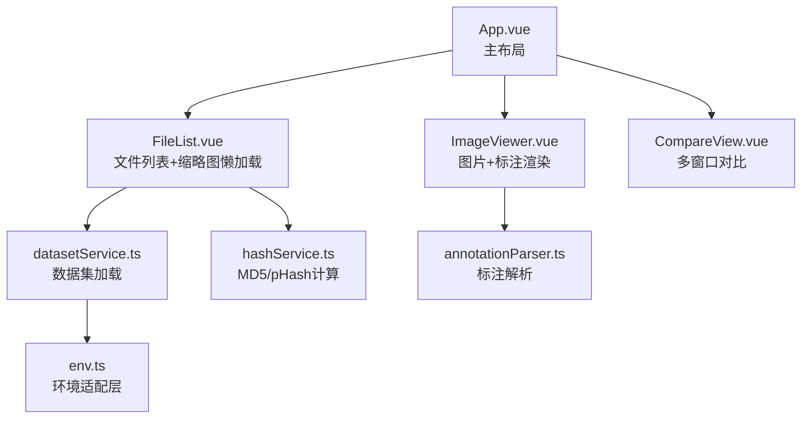

# PROJECT_ARCHITECTURE - 架构蓝图

> 最后更新：2026-07-05 | 只含模块依赖和 DTO，不含实现代码

## 项目定位

**DataSet Vision Compare** — AI 数据集管理工具，弥补市面开源工具短板。
- 浏览器版（Chrome/Edge `showDirectoryPicker`）
- 客户端版（Tauri 2，完整文件权限）

## 模块依赖图



## 模块说明与 DTO

### 1. env.ts — 环境适配层
统一浏览器/Tauri 文件操作 API。

| 导出 | 类型 | 说明 |
|------|------|------|
| `env` | `EnvType` | `'browser' \| 'tauri'` |
| `pickDirectoryBrowser()` | `Promise<FileSystemDirectoryHandle \| null>` | 选择文件夹 |
| `readDirBrowser(handle)` | `Promise<{path,file}[]>` | 递归读取 |
| `generateThumbnail(file, w, h)` | `Promise<string>` | 生成缩略图 DataURL |
| `getImageDimensions(file)` | `Promise<{width,height}>` | 获取图片尺寸 |

### 2. types.ts — 核心类型定义

```typescript
interface ImageFile {
  id: string; name: string; path: string;
  size: number; width: number; height: number;
  hash?: string; phash?: string;
  blob?: Blob; url?: string; thumbnail?: string;
}

interface DataSet {
  id: string; name: string;
  files: Map<string, ImageFile>;
  fileList: ImageFile[];
  totalCount: number; dupCount: number; uniqueCount: number;
}

interface ParsedAnnotation {
  type: 'bbox' | 'polygon' | 'circle';
  bbox?: [number, number, number, number];
  points?: [number, number][];
  category: string;
  normalized?: boolean;
  color?: string;
  confidence?: number;   // 置信度 (0-1)
  description?: string;  // 文本描述
}

interface CompareResult {
  type: 'duplicate' | 'similar' | 'unique' | 'onlyA' | 'onlyB';
  fileA?: ImageFile; fileB?: ImageFile;
  similarity: number; groupId: string;
}
```

### 3. datasetService.ts — 数据集加载
- 输入：`onProgress` 回调
- 输出：`Promise<DataSet>`

### 4. annotationParser.ts — 标注解析
- 输入：文件 Map、图片路径列表、颜色分配函数
- 输出：`Map<string, ParsedAnnotation[]>`（图片路径 → 标注列表）
- 支持格式：COCO JSON / LabelMe JSON / YOLO TXT / VOC XML

### 5. hashService.ts — 哈希计算
- MD5（`spark-md5`）、pHash（自定义实现）
- 通过 WebWorker 计算，不阻塞 UI

## 目录结构

```
src/
├── components/
│   ├── FileList.vue        # 文件列表（懒加载缩略图）
│   ├── ImageViewer.vue     # 图片查看器（标注渲染+描述悬浮窗）
│   ├── CompareView.vue     # 多窗口对比
│   └── MultiCompareView.vue
├── annotationParser.ts     # 标注解析器
├── annotationService.ts    # 标注匹配服务
├── datasetService.ts       # 数据集加载
├── datasetStructureAnalyzer.ts  # 结构识别
├── env.ts                  # 环境适配层
├── hashService.ts          # 哈希计算
├── types.ts                # 类型定义
└── worker.ts               # WebWorker 入口
```
